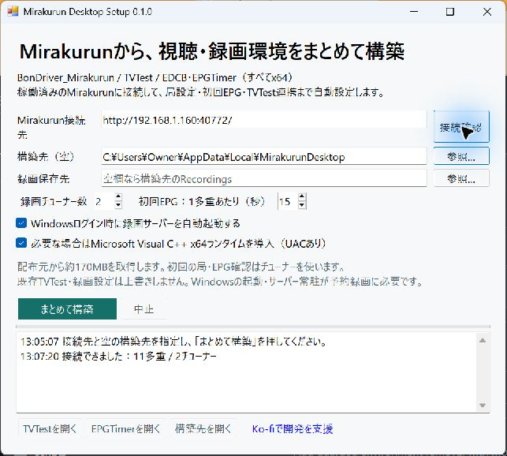
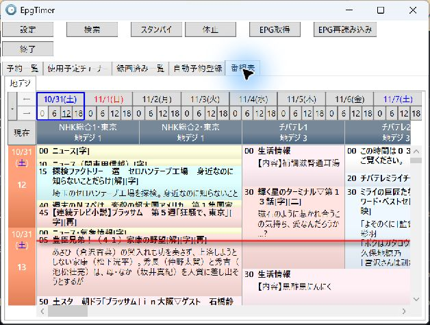

# Mirakurun Desktop Setup

稼働中のMirakurunに接続し、**BonDriver_Mirakurun・TVTest・EDCB / EPGTimerを「まとめて構築」ボタンで設定するWindows用アプリ**です。

[最新版をダウンロード](https://github.com/Long0823-1/Mirakurun-Desktop-Setup/releases/latest) · [Ko-fiで開発を支援](https://ko-fi.com/long0823)

## 使い方

1. ReleasesのZIPを展開して `Mirakurun-Desktop-Setup.exe` を起動します。
2. MirakurunのURLと空の構築先を指定します。例：`http://192.168.1.160:40772/`。初期値の `169.254.95.200` はTCL TVとの有線接続例です。お使いのアドレスへ変更してください。
3. **まとめて構築**をクリックします。必要なファイルの取得、局の実受信確認、初回番組表、チューナー数、TVTest連携、ショートカットを自動設定します。
4. 完了後、**TVTestを開く**で視聴、**EPGTimerを開く**で番組表・予約を利用できます。



Windows 10 / 11 x64、.NET Framework 4.8、接続可能なMirakurunと受信可能なチューナーが必要です。ARM64 Windowsは未検証です。Mirakurunサーバー自体はこのアプリでは構築しません。TCL Android TV側は [TCLTV-Mirakurun](https://github.com/Long0823-1/TCLTV-Mirakurun) を利用できます。

構築中はTVTestなど他の視聴クライアントを終了し、チューナーを空けてください。同時利用中は一部の局を取得できず、警告付きで完了する場合があります。

## 自動設定する内容

- 配布元からSHA-256で固定したx64版TVTest、EDCB、BonDriver_Mirakurunを取得。第三者の実行ファイルは本リリースに同梱しません。
- Mirakurun APIで局を取得し、実際のBonDriverでPAT / SDTからONID・TSIDを確認。TVTestのch2、EDCBのChSet4 / ChSet5を生成します。
- 各多重から短時間受信した番組情報をEDCB用に配置。初回は1多重15秒、最大2並列です。取得時間が短いため、全期間の番組情報が揃わない場合があります。
- TVTestのMPEG-2デコーダー・EVR・EpgTimerPlugIn、EPGTimerのTVTest呼び出し、録画保存先、毎朝5時のEPG取得を設定します。
- 現在のユーザーのデスクトップとスタートメニューにTVTest・EPGTimerのショートカットを作成。デスクトップでは構築先を識別するIDを名前に付け、別環境と区別します。選択時はログイン時にEpgTimerSrvを起動します。
- VC++ランタイムが不足している場合はMicrosoft公式インストーラーを取得します。ここではUAC承認が必要な場合があります。PCの自動再起動は行いません。

構築先は空のフォルダーに限定します。既存の予約環境への追加や更新ツールではありません。局設定に絶対パスが含まれるため、構築後のフォルダー移動は避けてください。失敗時は `.building-...` フォルダーとログを診断用に保持します。

## 番組表・予約録画

付属のEPGTimerショートカットとアプリの起動ボタンは、録画サーバーが初回EPGを読み込むのを待ってからEPGTimerを開きます。

初回起動時に番組表が空の場合は、サーバーの読み込みを待って「EPG再読み込み」を押してください。情報が不足する場合は「EPG取得」を実行します。EPG取得中はチューナーを使います。



別のEDCB環境のEpgTimerSrvとの同時起動は対応していません。構築した環境のショートカットから起動してください。

録画にはWindowsが動作していること、EpgTimerSrvが常駐していること、TV・Mirakurunへ接続できることが必要です。ログイン時起動はWindowsサービスではありません。WindowsやTVのスリープからの復帰、電源断からの録画、長時間・複数同時録画は本アプリの動作確認範囲外です。暗号化された放送の復号機能は追加しません。

削除する場合は構築先のTVTest・EPGTimer・EpgTimerSrvを終了し、`setup-result.json` の `shortcuts` に記載されたリンクと構築先を削除します。録画保存先を残すか確認してください。共有のVC++ランタイムは削除しません。

## 検証

2026-10-31、Windows x64とTCL Android TV上のMirakurunで、11多重・29映像サービス・2チューナーを確認しました。

- 実際のTVTestで地上波の映像表示を確認。
- EDCBのEPG解析DLLで初回番組データを解析し、最終再構築では2,130件の番組イベントを確認。
- EPGTimerの番組表画面に番組を表示できることを確認。
- ZIPのパス逸脱拒否、INI文字コード、実TSID反映、ChSet形式など13項目のテストに合格。

予約録画の完走、Windowsログイン時起動、ランタイム未導入PCでのUACインストールは未検証です。

## ソースからビルド

Visual Studio 2022のC++デスクトップ開発、.NET Framework 4.8開発ツール、.NET SDKが必要です。

```powershell
./scripts/build.ps1
dotnet run --project tests/Tests.csproj -c Release
```

配布物は `build/release/` に生成されます。配布元・ハッシュは `catalog.json` を参照してください。アップデート時は配布元ソースとライセンスを確認してハッシュも更新します。

本アプリはMITライセンスです。各ダウンロードソフトのライセンスは個別に適用されます。[第三者ソフトについて](THIRD-PARTY-NOTICES.md)。
